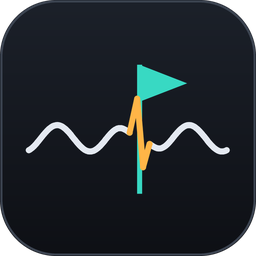
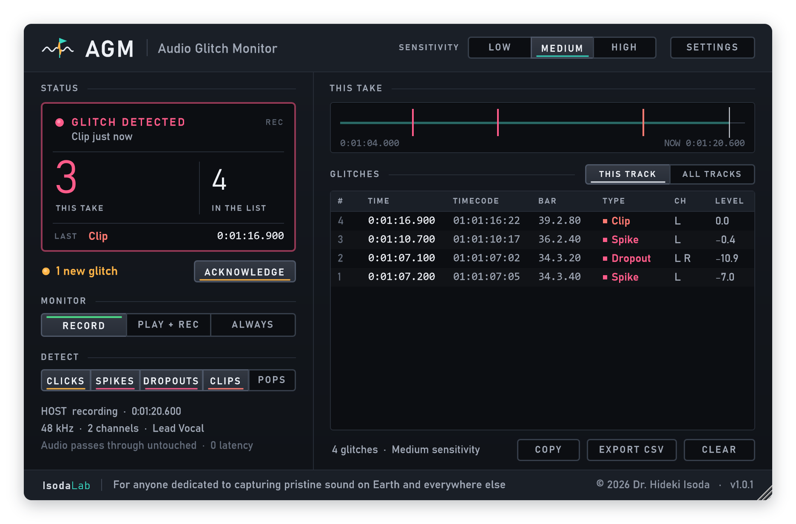
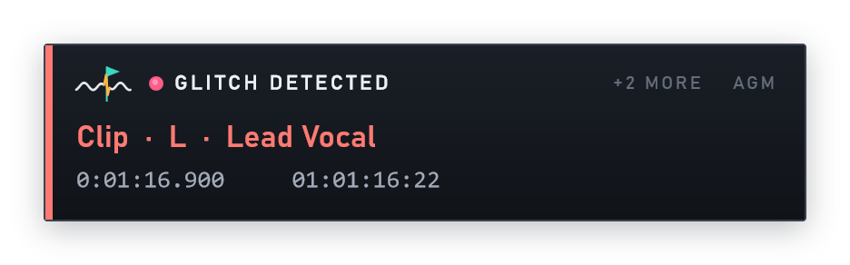
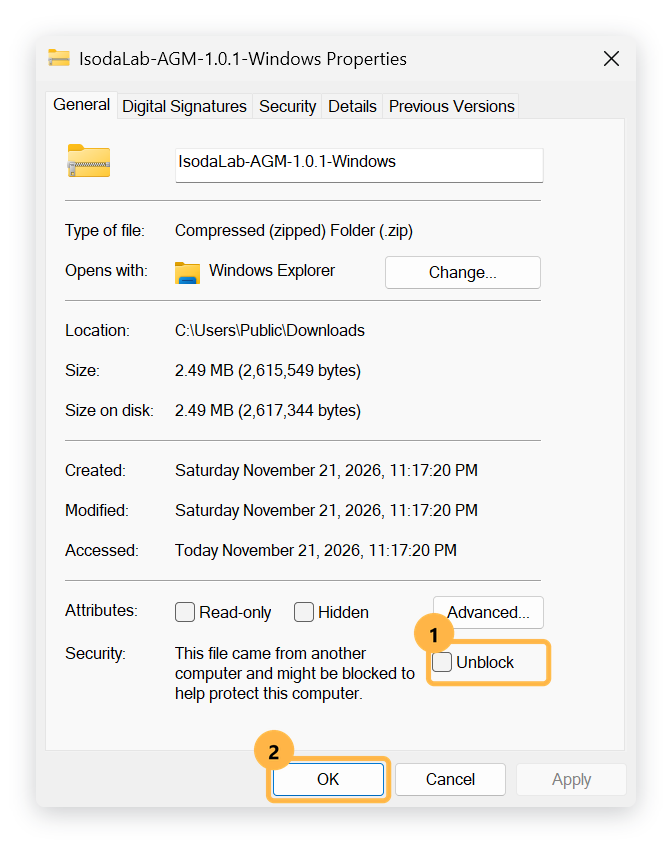
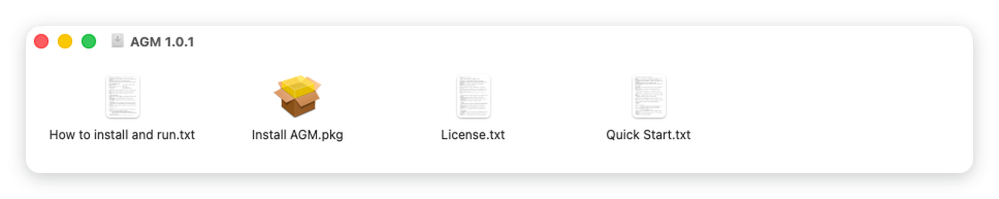
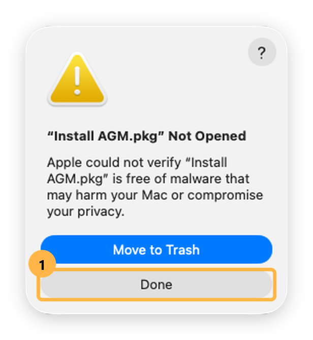
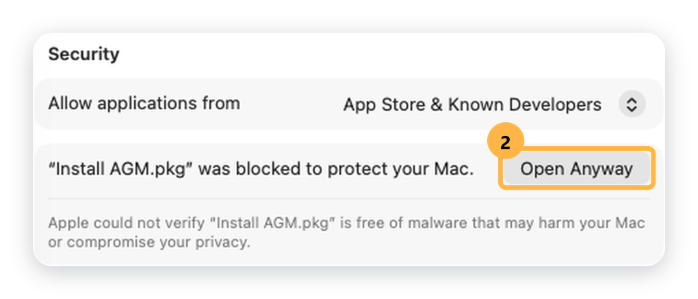
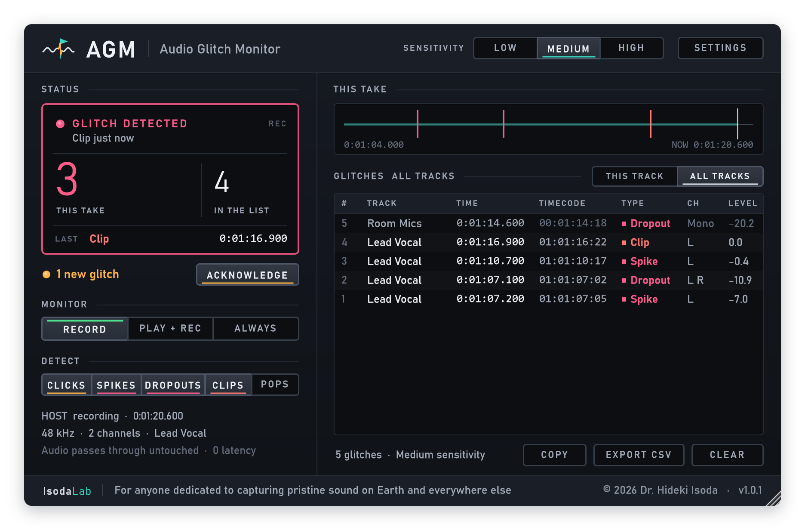
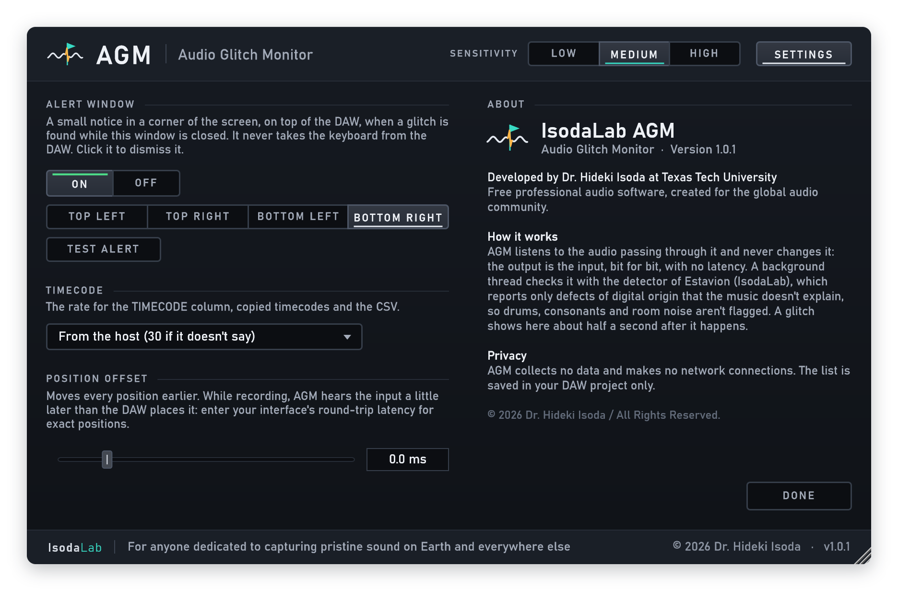

<p align="center">
  
</p>

<h1 align="center">AGM</h1>
<p align="center"><b>Audio Glitch Monitor</b><br>
IsodaLab<br>
<i>Free professional audio software, created for the global audio community.</i></p>

<p align="center">
  <a href="https://github.com/isodalab/agm/releases/tag/v1.0.1"><b>Download 1.0.1</b></a> ·
  <a href="#install-on-windows">Install on Windows</a> ·
  <a href="#install-on-macos">Install on macOS</a> ·
  <a href="#install-on-linux">Install on Linux</a> ·
  <a href="#using-agm">Using AGM</a>
</p>

<p align="center">
  
</p>

**AGM is free plug-in software for anyone dedicated to capturing pristine sound on Earth and everywhere else.** It watches the audio you record and tells you the moment a digital glitch happens, while the musicians are still in the room and the take can still be done again.

A buffer underrun, a lost packet on an audio network, an interface losing clock sync, a full-scale over: digital glitches are short, often quiet, and easy to miss on headphones in a busy session. They are much harder to fix in the edit, and impossible to fix once everyone has gone home. AGM listens to every sample that reaches it, with the calibrated detector of [Estavion](https://github.com/isodalab/estavion), and flags only defects of digital origin. Drums, consonants, breaths, page turns and room noise aren't flagged.

AGM is a VST3 plug-in for **Windows**, a VST3 and Audio Unit plug-in for **Macs with Apple silicon**, and a VST3 and LV2 plug-in for **Linux**. In your DAW it appears as **AGM** by **IsodaLab**, in the *Analyzer* category.

## Download

| Platform | Package | Requirements |
|---|---|---|
| **Windows** | [IsodaLab-AGM-1.0.1-Windows.zip](https://github.com/isodalab/agm/releases/download/v1.0.1/IsodaLab-AGM-1.0.1-Windows.zip) | 64-bit Windows 10 or 11, a VST3 host |
| **macOS** | [IsodaLab-AGM-1.0.1-macOS-AppleSilicon.dmg](https://github.com/isodalab/agm/releases/download/v1.0.1/IsodaLab-AGM-1.0.1-macOS-AppleSilicon.dmg) | Mac with Apple silicon (M1 or later), macOS 11 or later, a VST3 or Audio Unit host |
| **Linux** | [IsodaLab-AGM-1.0.1-Linux-x86_64.zip](https://github.com/isodalab/agm/releases/download/v1.0.1/IsodaLab-AGM-1.0.1-Linux-x86_64.zip) | 64-bit Linux (x86_64), glibc 2.35 or later (Ubuntu 22.04+, Debian 12, Fedora 36+, Arch, …), a VST3 or LV2 host |

The Windows and Linux packages contain the plug-in, a step-by-step install guide, the Quick Start guide and the license; the Linux package adds a small install script. The macOS disk image contains an installer that puts both the VST3 and the Audio Unit in place, with the same guides. [SHA256SUMS.txt](https://github.com/isodalab/agm/releases/download/v1.0.1/SHA256SUMS.txt) lists the checksums. There is no account and no license key; installation takes about a minute.

## What it does

- **Tells you at once.** About half a second after a glitch, the status display turns red: *GLITCH DETECTED*, with its type. A lamp stays lit until you acknowledge it, so you know even if you were looking away.
- **An alert on top of your DAW.** With AGM's window closed, or behind the project window, a small alert appears in a corner of the screen you're working on. It never takes the keyboard from your DAW.
- **Only digital defects.** Clicks, spikes, dropouts (the audio cut to digital silence and back), clips and invalid samples. Estavion's detector tells a defect from music: drums, consonants and room noise aren't flagged.
- **Where it happened.** Every glitch is listed with its time, timecode (your DAW's frame rate and start time) and bar.beat, and saved with your project. Double-click to copy the timecode; copy the list or export it as CSV.
- **The whole session.** *This take* counts the glitches of the take being recorded, the take strip marks each one, and *All tracks* lists the glitches of every track with AGM, by track name.
- **100% transparent.** AGM only reads the audio. The output is the input, bit for bit, with zero latency, and in 64-bit hosts natively in 64-bit. It can stay on every track you record.
- **Light on the computer.** The checking runs on a background thread shared by every AGM in the project, never on the audio thread.

<p align="center">
  
</p>

## Install on Windows

1. **Unblock the download.** Right-click the ZIP → **Properties**. At the bottom of the *General* tab, tick **Unblock** (1), then click **OK** (2). Do this *before* extracting, so Windows doesn't flag every file inside.

   <p align="center"></p>

2. **Extract and copy.** Right-click the ZIP → **Extract All…**, then copy the **`IsodaLab AGM.vst3`** folder into `C:\Program Files\Common Files\VST3\`. Click **Continue** when Windows asks for administrator permission.
3. **Rescan plug-ins** in your DAW (see [Finding AGM in your DAW](#finding-agm-in-your-daw)).

<details>
<summary><b>If Windows or your browser blocks it</b></summary>

AGM is free and isn't code-signed with a paid certificate, so Windows treats it as *unrecognized*. It contains no network code and collects no data.

| What you see | What to do |
|---|---|
| **Edge:** "…isn't commonly downloaded" | Hover over the download, click **…** → **Keep** → **Show more** → **Keep anyway**. |
| **Chrome:** "Suspicious download" | Click **Keep** in the downloads list. |
| Your antivirus quarantines the files | Restore them and add an exception for the `IsodaLab AGM.vst3` folder. |
| **Smart App Control** (Windows 11): your DAW lists AGM as failed, or doesn't show it after a rescan | Smart App Control can refuse unsigned plug-ins and has no override. The only way around it is to switch it off under *Windows Security → App & browser control → Smart App Control settings*. On many Windows 11 versions it can't be switched back on without resetting Windows, so weigh that before you do it. |

</details>

## Install on macOS

1. **Download** `IsodaLab-AGM-1.0.1-macOS-AppleSilicon.dmg` and double-click it. It opens with the installer, the guides and the license.

   <p align="center"></p>

2. **Double-click `Install AGM.pkg`.** macOS shows an alert saying it was *Not Opened*. That's expected: AGM is free and isn't notarized with a paid Apple Developer ID. Click **Done** (1), not *Move to Trash*.

   <p align="center"></p>

3. **Open System Settings → Privacy & Security** and scroll down to **Security**. Next to *"Install AGM.pkg" was blocked to protect your Mac*, click **Open Anyway** (2). Enter your password (or use Touch ID) and confirm with **Open Anyway**.

   <p align="center"></p>

4. **The installer opens.** Click **Continue**, **Agree** to the license, then **Install**. It puts both the VST3 and the Audio Unit in place.

## Install on Linux

1. **Extract** the download with your file manager, or in a terminal:

   ```bash
   unzip IsodaLab-AGM-1.0.1-Linux-x86_64.zip
   ```

2. **Run the install script** from the extracted folder:

   ```bash
   cd IsodaLab-AGM-1.0.1-Linux-x86_64
   ./install.sh
   ```

   It copies the VST3 to `~/.vst3` and the LV2 to `~/.lv2`, so no root password is needed. Running it again updates an existing installation; `./install.sh --uninstall` removes AGM. (If your file manager extracted it without the executable bit, run `sh install.sh`.)
3. **Rescan plug-ins** in your DAW (see [Finding AGM in your DAW](#finding-agm-in-your-daw)).

## Finding AGM in your DAW

AGM is listed as **AGM** by **IsodaLab**, in the *Analyzer* category. If it doesn't appear, rescan your plug-ins:

| DAW | How to find AGM |
|---|---|
| **Ableton Live** | Settings → Plug-Ins → turn on the VST3 system folder (and Audio Units on a Mac) → **Rescan**. |
| **Ardour / Mixbus** | Edit → Preferences → Plugins → **Scan for Plugins**. On Linux, AGM is available as VST3 and LV2. |
| **Bitwig** | Settings → Locations (on Linux, make sure `~/.vst3` is listed); Bitwig rescans on start. |
| **Carla** (Linux) | Add Plugin → **Refresh**. |
| **Cubase / Nuendo** | Studio → VST Plug-in Manager → Rescan all. If AGM is listed as blocklisted, select it and click **Reactivate**. |
| **DaVinci Resolve Studio** | DaVinci Resolve → Preferences → System → Audio Plugins: make sure the VST3 folder (and Audio Units on a Mac) is enabled, then restart Resolve. |
| **Digital Performer** | DP checks plug-ins when it starts. If AGM is missing, open Preferences → Audio Plug-ins, make sure AGM is enabled, and restart DP. |
| **FL Studio** | Options → Manage plugins → **Find installed plugins**. |
| **GarageBand** | Settings → Audio/MIDI → tick **Enable Audio Units**. |
| **Logic Pro** | Logic Pro → Settings → Plug-in Manager. If AGM shows *failed*, select it and click **Reset & Rescan Selection**. Insert it from an Audio FX slot → Audio Units → IsodaLab → AGM. |
| **Pro Tools** | **Not supported.** Pro Tools only loads plug-ins in Avid's AAX format. |
| **Pyramix** (Windows) | Pyramix picks AGM up from the standard VST3 folder. Restart Pyramix after installing (listed under IsodaLab). |
| **Qtractor** (Linux) | View → Options → Plugins: make sure `~/.lv2` (or `~/.vst3`) is among the paths, then restart Qtractor. |
| **Reaper** | Settings → Plug-ins → VST → **Re-scan** (on Linux, make sure `~/.vst3` is in the path list). |
| **Renoise** | Preferences → Plug/Misc → **Rescan**. |
| **Sequoia Pro** (Windows) | Make sure `C:\Program Files\Common Files\VST3` is among Sequoia's VST plug-in folders, then rescan or restart Sequoia. |
| **Studio One** | Settings → Locations → VST Plug-Ins → **Reset Blocklist**, then restart. |
| **Tracktion Waveform** | Settings → Plugins → **Scan for new plugins**. |

## Using AGM

**Put AGM where it hears what you record.** Insert it on each track you record (any slot: it doesn't change the sound), and make sure the input reaches it while recording:

- **Most DAWs:** turn input monitoring on for the track, so the track's plug-ins process the input.
- **Cubase / Nuendo:** or put AGM on the *Input Channel*; its inserts process the input before it is recorded.
- **Reaper:** or put AGM in the track's *Input FX*.
- **Logic Pro:** turn on Input Monitoring (the **I** button) for the track.

To check a whole interface at once, put AGM on a multichannel track or bus fed by all inputs (up to 8 channels per AGM).

<p align="center">
  
</p>

### Monitor modes

| Mode | AGM checks… |
|---|---|
| **Record** (default) | Only while your DAW records. Each recording pass starts a new take; in loop recording, each loop does. Audio Units (Logic Pro, GarageBand) and LV2 plug-ins can't be told the host is recording: there, *Record* checks whenever the transport runs. |
| **Play + Rec** | While your DAW plays or records: also checks playback. |
| **Always** | All the time, even with the transport stopped. |

### Sensitivity and what to look for

| Sensitivity | Lists |
|---|---|
| **Low** | Only clear, loud defects. |
| **Medium** (default) | The calibrated setting: defects of digital origin that you can hear. |
| **High** | Also very quiet and ultrasonic glitches, and anything right at a transport start or stop. |

Changing the sensitivity re-filters the list instantly, for glitches already found. **Detect** chooses the types: *Clicks* (short disturbances of digital origin), *Spikes* (clicks that jump sharply out of everything around them), *Dropouts* (the audio cut to exact digital silence and back: buffer underruns, lost packets), *Clips* (3 or more samples at full scale, or beyond it) and *Pops* (short isolated low thumps; off by default, since kick drums and plosives look like pops). Invalid samples (NaN or infinity from a broken plug-in or driver upstream) are always reported.

### The list

Newest first, with time, timecode, bar.beat, type, channels and level. **Double-click** a row to copy its timecode, to paste into your DAW's position field; **right-click** to copy the time or bar.beat; hover for details. **Copy** puts the list on the clipboard for a spreadsheet or an email, **Export CSV** saves it, and **Clear** empties it (click twice).

### Settings

<p align="center">
  
</p>

- **Alert window:** on or off, and which corner of the screen. *Test Alert* shows one now.
- **Timecode:** from your DAW (its frame rate and start time, where it tells plug-ins), or a fixed rate.
- **Position offset:** while recording, AGM hears the input a little after your DAW places it on the timeline. For exact positions, enter your interface's round-trip latency (shown in your DAW's audio settings).

### Good to know

- A glitch is reported about half a second after it happens: AGM looks at the sound just before and after it, to tell a defect from music.
- Positions come from your DAW's timeline. If you move or trim the recorded clip later, its glitches don't move with it.
- AGM checks the audio that reaches it. A problem that happens later, for example while the DAW writes the file, isn't seen.
- If the computer is overloaded, AGM says so (*Fell behind*) and how much it couldn't check. The audio itself is never affected.
- Automatic detection is an aid to listening, not a substitute for it.

## Privacy

AGM collects no data. It makes no network connections, has no analytics or telemetry, and needs no account, registration or license key. It reads the audio passing through it only on your own computer and never changes it. The list and the settings are stored in your DAW project, nowhere else; a CSV file is written only when you export one.

## License

AGM is **freeware**: free for personal, educational and commercial use on any number of computers. You're welcome to share the unmodified packages with anyone, free of charge, with the license and copyright notice intact. It is not open source. The full terms are in [LICENSE.txt](LICENSE.txt).

Built with the [JUCE](https://juce.com) framework. VST is a registered trademark of Steinberg Media Technologies GmbH; Audio Units is a trademark of Apple Inc. The macOS and Linux versions embed the Barlow typeface (SIL Open Font License 1.1). Windows is a trademark of Microsoft Corporation; macOS of Apple Inc.; Linux is a registered trademark of Linus Torvalds.

## About

Developed by **Dr. Hideki Isoda** at **Texas Tech University**. Created as a contribution to the global audio community, this software is provided free of charge to support audio professionals, educators, students, and researchers worldwide.

This project is entirely self-funded, and I have not applied for any grants. I also see it as a good example for the Music Informatics and Recording Technology courses I teach at TTU, and I hope it inspires my students.

## Transparency

I do use AI tools like ChatGPT or Claude to help organize my ideas and catch errors, but most of the work comes from decades of coding practice and real-world professional experiences. I still design programs like this the old-fashioned way, with notebooks and a whiteboard, before the code takes shape. That said, AI has cut my build time from many months of late nights to weeks!

<sub>© 2026 Dr. Hideki Isoda / All Rights Reserved.</sub>
